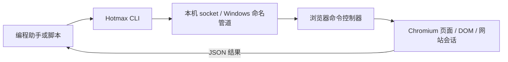

<div align="center">
  
  <h1>Hotmax Browser</h1>
  <p>Open-source AI browser for AI agents and CLI browser automation.</p>
  <p><strong>让开发工具操作网页，把鼠标和桌面留给你。</strong></p>
  <p>开源 AI 浏览器 · 浏览器自动化 · Codex / AI Agent · CLI / DOM</p>
  <p><a href="docs/getting-started.md">安装与使用</a> · <a href="docs/contracts/browser.md">命令接口</a> · <a href="docs/architecture.md">架构</a> · <a href="CONTRIBUTING.md">参与贡献</a></p>
</div>

## 为什么做这个浏览器

使用 Codex 等 AI 编程助手处理网页任务时，我们希望它能读取页面、填写表单、点击链接和获取结果，同时继续使用自己的电脑。

Hotmax Browser 是面向 AI Agent 的开源浏览器和网页自动化工具，将网页操作开放为本机命令。编程助手通过 CLI 与浏览器通信，在页面内执行 JavaScript、读取 DOM，完成网页数据提取（Web Scraping）、表单填写（Form Automation）和自动化工作流；常规操作无需截取整个屏幕、推断坐标，也无需移动系统鼠标。

浏览器窗口仍然可见，你可以随时查看过程、手动登录或接管。网页数据和登录态保存在本机；工具不内置模型、AI 服务或遥测。访问的网站仍按各自规则处理请求和数据。

## 它如何工作



| 环节 | 基于截图与坐标的控制 | Hotmax Browser |
| --- | --- | --- |
| 理解页面 | 截图，由模型识别画面中的目标 | 读取 DOM、文本、表单或所需数据 |
| 执行动作 | 根据坐标模拟鼠标和键盘输入 | 在页面内调用 JavaScript 与浏览器接口 |
| 获得结果 | 再次截图，检查视觉变化 | 返回脚本选定的 JSON 结果 |
| 桌面影响 | 可能占用鼠标、焦点和可见屏幕 | 常规 CLI 操作不移动系统鼠标；截图不主动聚焦窗口 |
| 模型输入 | 图片及重复观察 | 按需返回少量文本与结构化字段 |

这里比较的是基于截图的控制方式；部分其他自动化工具也支持 DOM 或可访问性接口。Canvas、视觉排版检查、验证码和系统原生对话框并不都能用 DOM 操作替代。启动应用、手动切换窗口及网站原生提示仍可能影响焦点。

实际速度与 token 用量取决于页面、模型、任务和返回数据量。可复现的比较方法见 [性能评估](docs/benchmarks.md)。

## 快速开始

面向 **macOS 和 Windows**，两者使用同一份源码。需要 **Node.js 22.12+**、npm 和网络连接；`npm ci` 会下载对应系统的 Electron 运行时。项目以源码形式发布，无需安装包。

下载仓库源码并进入根目录：

```sh
git clone https://github.com/sunweinan/hotmax-browser.git
cd hotmax-browser
npm ci
npm start
```

Windows PowerShell 使用 `npm.cmd ci` 和 `npm.cmd start`；安装依赖后，也可以双击 `start-windows.cmd`。macOS 可以双击 `启动浏览器.command`。

macOS Apple Silicon 已运行验证；Windows 适配代码已提供，尚未进行实机验证。

浏览器默认打开 `https://hotmax.chat`。保持窗口运行，在另一个终端中执行：

```sh
# 列出标签，取得 tabId
node bin/hotmax-browser.js tabs

# 打开网站，返回新标签的 tabId
node bin/hotmax-browser.js open

# 将 examples/read-page.json 中的 tabId 改为实际 ID
node bin/hotmax-browser.js evaluate "@examples/read-page.json"
```

也可以运行 `npm link`，随后使用 `hotmax-browser` 命令。参数支持 JSON 字符串、`@file.json` 和标准输入 `-`，便于处理较长脚本。

Windows 对应使用 `npm.cmd link` 和 `hotmax-browser.cmd`；也可继续通过 `node bin/hotmax-browser.js` 调用。

```sh
hotmax-browser evaluate "@examples/read-page.json"
```

示例中的标签 ID 需要替换为本次打开的标签。更多操作见 [使用指南](docs/getting-started.md) 与 [示例](examples/README.md)。

## 能做什么

- 创建、切换、关闭标签，导航、前进、后退和刷新。
- 读取文本、HTML 和页面数据，通过 JavaScript 操作表单与元素。
- 使用不同 profile 隔离网站 Cookie 和存储，并在重启后保留登录态。
- 使用页面或浏览器会话发起请求，将响应保存为文件。
- 获取网络元信息，按需读取响应正文或截图。
- 从终端、Node.js 程序和具备命令执行能力的编程助手调用同一控制协议。

项目定位为独立、可由代码控制的公共浏览器。每次启动打开默认首页，不恢复上次的标签。

## 本地与可控

控制接口使用 macOS 的 Unix socket 或 Windows 命名管道，不开放 HTTP 控制端口。macOS socket 权限为 `0600`；Windows 使用系统默认的管道访问权限，不开启所有用户读写。同一系统用户的其他进程仍可能控制浏览器，详见 [控制契约](docs/contracts/browser.md)。

用户空间独立位于 macOS 的 `~/.hotmax-browser` 或 Windows 的 `%USERPROFILE%\.hotmax-browser`，不在源码或应用包中。登录相关 Cookie、Local Storage 和 IndexedDB 按 profile 保存；HTTP 缓存和脚本磁盘缓存关闭，离线资源缓存在账户加载及正常退出时清理。使用 `HOTMAX_BROWSER_DATA_DIR` 可以建立独立实例，浏览器和 CLI 需要使用相同设置。网站摄像头、麦克风、定位等权限默认不授予，可在本机配置中按来源开启。

用户权限配置位于用户空间的 `config.json`。Cookie 快照保存在本地私有文件中，不属于源码或发布包。不要将数据目录、真实 Cookie、授权头或网页私密内容提交到仓库。详细边界见 [安全说明](SECURITY.md)。

## 开发与构建

```sh
npm test                 # 单元与控制协议测试
npm run test:browser     # 自动创建、退出隔离浏览器进行验收
npm run check            # 源码格式检查
npm run package          # 可选：为当前 macOS/Windows 架构构建应用目录
npm run release:source   # 生成仅含发布文件的源码包和 SHA-256
```

源码可直接运行；可选的本地应用构建输出到 `dist/apps/`，不生成安装程序。本地构建不会自动上传 GitHub，也不会签名或公证应用。[发布指南](docs/releasing.md) 说明构建、许可、版本和 GitHub 发布流程。

## 文档

- [安装、部署与日常使用](docs/getting-started.md)
- [命令、参数、状态与数据目录](docs/contracts/browser.md)
- [模块结构与数据流](docs/architecture.md)
- [性能评估方法](docs/benchmarks.md)
- [贡献约定](CONTRIBUTING.md) · [安全报告](SECURITY.md) · [更新记录](CHANGELOG.md)

---

<sub>Hotmax Browser 使用 MIT 许可证。基于 Electron / Chromium；完整许可见 <a href="LICENSE">LICENSE</a> 与 <a href="THIRD_PARTY_NOTICES.md">第三方声明</a>。</sub>
