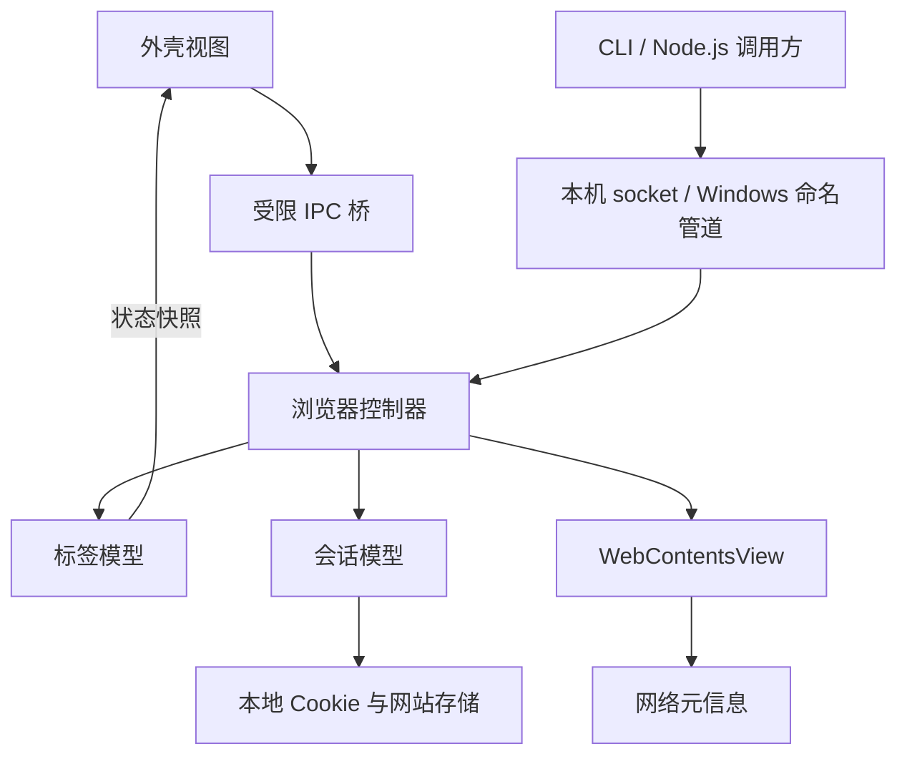

# 架构

Hotmax Browser 是 Electron 桌面应用。Chromium 承载网站，Node.js 主进程管理窗口、账户会话和本机控制协议。运行时业务代码不依赖特定网站或 AI 服务。

## 模块边界

| 层 | 文件 | 职责 |
| --- | --- | --- |
| 应用生命周期 | `src/main.cjs` | 创建窗口、校验 IPC 来源、绑定本机服务、退出前保存会话 |
| 控制器 | `src/browser.cjs` | 统一分发导航、标签、页面脚本、请求及截图命令 |
| 标签模型 | `src/tabs.cjs` | 标签注册、当前选择、快照与资源释放 |
| 会话模型 | `src/profiles.cjs` | profile 路径校验、Cookie 恢复、持久化队列、网站权限 |
| 网络模型 | `src/network.cjs` | 收集有界、脱敏的请求元信息 |
| 外壳视图 | `src/shell.html`、`src/shell.css`、`src/shell-view.js` | 展示标签、地址、导航按钮与错误 |
| 外壳控制器 | `src/shell.js` | 用户动作与状态更新 |
| IPC 桥 | `src/preload.cjs` | 只向本地外壳提供控制接口 |
| 配置与路径 | `src/config.cjs`、`src/paths.cjs` | 品牌、首页、用户配置与独立用户空间 |
| 本机通信 | `src/runtime.js` | JSON 文件、本机 socket / Windows 命名管道客户端及服务端 |
| CLI | `bin/hotmax-browser.js`、`src/cli.js` | 参数读取、JSON 输出、退出码 |

## 数据流

网页不加载外壳 preload；其 Node.js 集成关闭，contextIsolation 与 sandbox 开启。外壳只加载本地资源，由 CSP 约束。RPC 服务不监听 TCP 端口。macOS 使用文件系统中的 Unix socket；Windows 使用命名管道，连接关闭后由系统回收，跳过文件权限修改与 unlink。命令分发、请求格式和网页操作共用同一实现。

## 生命周期

应用取得单实例锁后创建窗口和控制器，加载外壳，再启动 RPC 并打开首页。同一数据目录仅允许一个实例。

关闭标签时先移除注册项，解绑页面和网络事件，然后释放调试连接与 WebContents。关闭最后一页会创建空白标签。退出应用先停止标签活动并完成会话保存，清理普通网页缓存，再关闭 socket 和窗口。

HTTP 与脚本磁盘缓存关闭，离线资源缓存不跨正常退出保留。外壳会话位于系统临时目录，登录相关存储位于源码之外的用户空间；应用不保存标签列表。

会话初始化按 profile 共享 Promise，避免并发开页重复恢复 Cookie；持久化按 profile 排队，避免快照写入顺序冲突。

## 发布边界

用户空间中的 config.json、账户数据、依赖目录和构建产物不属于源码。发布脚本按 `scripts/release-files.mjs` 中的文件白名单暂存内容，并拒绝符号链接。

应用包只包含运行代码、品牌资源与许可文本。Electron、Chromium 和其他随运行时分发的第三方声明保留在应用资源目录；构建工具不进入应用的 Node.js 运行依赖。

项目以源码形式发布，macOS 和 Windows 均通过 npm 启动；start-windows.cmd 提供 Windows 双击入口。应用构建是可选的本地开发命令，不作为使用前提。

完整输入输出与用户配置见 [控制契约](contracts/browser.md)。
